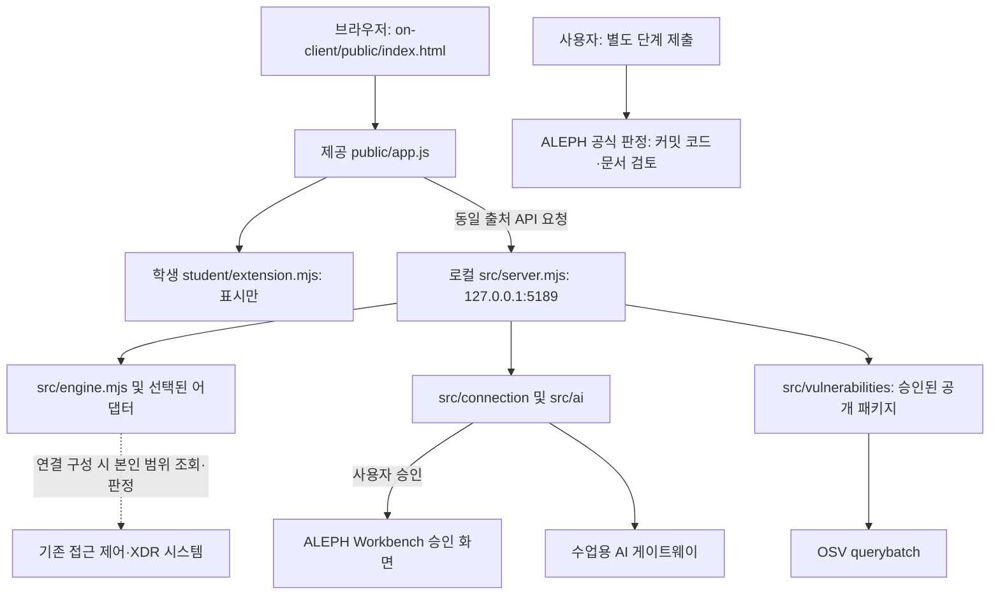

# 이지스 학생 실행 설명서 · 21단계와 마무리 작업

2026-11-05 안내 정리: 실제 막힌 단계·실행 오류는 전달되지 않았습니다. 버튼명과 다른 PC의 폴더 진입 절차를 현재 코드에 맞췄으며, 재현하지 않은 오류를 고쳤다고 기록하지 않습니다.

## 목적과 읽는 범위

이지스는 로그인·기기·세션, 업무 앱 판정, 보안 기록, AI 설명·조치 상태, 설치 패키지 취약점 조회 결과를 표시하는 학생 화면입니다. 제공 시작 틀의 화면 이름은 케셰브이며, 이름 차이는 연결 성공 여부를 뜻하지 않습니다.

이 저장소에는 앞 단계 웹 자료실과 후반 단계 로컬 앱이 함께 있습니다. 후반 화면은 `on-client`에서 실행합니다. 루트의 Vercel 배포 주소와 로컬 앱 주소를 혼동하지 않습니다.

| 실행 대상 | 위치 | 주소·역할 |
| --- | --- | --- |
| 1~12단계 웹 자료실 | 루트 `api/`, `public/`, `src/` | `https://choi-bujang-secret-vault-chi.vercel.app` · 배포된 자료실, 이번 문서 작업에서 배포 상태 재검증 안 함 |
| 후반 단계·마무리 로컬 앱 | `on-client/` | `http://127.0.0.1:5189/` · 이 문서의 실행 대상 |
| 학생 설명서 | `docs/STUDENT_RUNBOOK.md` | 코드와 실행 경계를 읽는 문서, 서버 실행 코드가 아님 |

## 지원 환경과 확인한 버전

2026-11-03 현재 PC에서 아래 명령을 직접 실행해 확인했습니다.

| 항목 | 확인값 | 근거·범위 |
| --- | --- | --- |
| 운영 환경 | Windows PowerShell | Windows 경로·개인 보관소를 쓰는 제공 실행 도구 |
| Node.js | v24.19.0 | `node --version` · `on-client/package.json`의 수업 기준 24.19.0과 일치 |
| npm | 11.17.0 | `npm --version` · 별도 npm 버전 고정은 없음 |
| PowerShell | 5.1.26100.9711 | `$PSVersionTable.PSVersion.ToString()` |
| 앱 시작 틀 | 0.2.21 | `on-client/package.json` |

실행 도구는 Node 22~24를 허용하지만 이 PC에서 직접 확인한 버전은 24.19.0입니다. 다른 Node 버전·Windows 계정·새 PC·macOS·Linux에서 실행을 확인한 것은 아닙니다. 설치형 전체 앱의 바로가기 실행도 이번 개발 폴더 실행과 별개이며 미확인입니다.

`on-client/package.json`에는 외부 의존성 목록이 없고 `on-client/package-lock.json`도 없습니다. 로컬 앱을 켜기 위해 `on-client`에서 `npm ci`를 실행하지 않습니다. 루트에는 별도의 package.json·package-lock.json과 자료실 의존성이 있으며, 그것을 후반 앱의 설치 목록이라고 설명하지 않습니다. Docker는 이 실행 도구의 필수 조건이 아닙니다.

## 폴더와 코드 경계

```text
choi-bujang-secret-vault/
├─ README.md                     학생 프로젝트 전체 안내
├─ aleph.config.json             기존 방어전 설정(step 12), 후반 단계 번호와 별개
├─ api/ public/ src/             앞 단계 웹 자료실
├─ package.json package-lock.json  웹 자료실 패키지·잠금 파일
├─ docs/
│  ├─ STUDENT_RUNBOOK.md          이 설명서
│  └─ progress/stage-*.md         단계별 계획·실행·미확인 기록
└─ on-client/
   ├─ package.json               로컬 앱 0.2.21, start/demo/check/package-app
   ├─ student/extension.mjs       학생 화면 렌더러
   ├─ student/engine-adapter.mjs  제공된 본인 범위 엔진 어댑터 경계
   ├─ public/index.html app.js    제공 화면·버튼·요청·상태 관리
   ├─ public/vulnerabilities-view.mjs  제공 OSV 결과 검증·표시
   ├─ src/server.mjs              제공 로컬 HTTP 서버
   ├─ src/engine.mjs              기존 엔진 연결·예제·미연결 처리
   ├─ src/engine/sdp-host.mjs     선택적 기존 시스템 연결
   ├─ src/ai/ src/connection/     AI·계정 승인·개인 보관소 경계
   ├─ src/vulnerabilities/       승인된 공개 패키지 OSV 조회
   └─ tools/start-alekov.ps1      개발 폴더 실행 도구
```

| 구분 | 하는 일 | 하지 않는 일 |
| --- | --- | --- |
| 학생 `extension.mjs` | 받은 스냅샷을 createElement·textContent로 표시 | 인증·집행·OSV 요청·티켓 저장을 직접 수행하지 않음 |
| 제공 `public/app.js` | 버튼, API 요청, 검증, 취소·세대 검사, 학생 DOM 교체 | 제공된 기능 자체를 학생 성취라고 계산하지 않음 |
| 제공 서버·연결 모듈 | 신원·권한·원천 응답 검증, 로컬 비밀 보관, API 중계 | UI의 성공 문구만으로 실제 원천 효과를 인정하지 않음 |
| 기존 접근 제어·XDR 시스템 | 본인 범위 조회·판정·기록의 원천 | AI 승인만으로 자동 연결되지 않음 |
| 수업용 Workbench AI | 학생 코드 작성을 도움 | 앱 사건 설명이나 ALEPH 공식 판정과 동일하지 않음 |
| 앱 AI 게이트웨이 | 모델 목록과 사건 설명의 별도 요청 경로 | 목록 조회만으로 설명·조치 성공을 보장하지 않음 |
| ALEPH 공식 판정 AI | 제출 커밋의 코드·문서 일치를 검토 | 21단계 명령을 실행하거나 새 환경 재현을 인증하지 않음 |

## 처음 켜기

Node가 없다면 공식 Node 배포에서 수업 기준 버전을 설치하고 새 PowerShell을 엽니다. 이번 작업에서는 설치하지 않았습니다. 기존 프로젝트를 새 ZIP으로 덮어쓰거나 개인 설정을 삭제하지 않습니다.

1. 파일 탐색기에서 **자신의 프로젝트 폴더 안 `on-client`**를 엽니다. 그 안에 `package.json`, `student` 폴더, `tools` 폴더가 함께 보여야 합니다. 원래 작성자의 경로 `D:\SR\choi-bujang-secret-vault\on-client`는 다른 PC에 있을 필요가 없습니다. 새 프로젝트를 만들거나 기존 폴더를 옮기지 않습니다.
2. 파일 탐색기의 주소 표시줄에 `powershell`을 입력하고 Enter를 누릅니다. 아래 명령으로 위치와 실행 파일을 확인합니다. True면 실행 파일이 있는 폴더입니다. False면 실행하지 말고 파일 탐색기에서 올바른 `on-client`를 다시 엽니다.

```powershell
Get-Location
Test-Path .\tools\start-alekov.ps1
```

3. 이미 켜져 있는 이 앱의 PowerShell 창이 있다면 중복 실행하지 말고 그 창에 표시된 주소를 사용합니다. 서버가 꺼져 있다면 **일반 권한**의 위 PowerShell 창에서 실행합니다.

```powershell
powershell -NoProfile -ExecutionPolicy Bypass -File .\tools\start-alekov.ps1
```

4. 정상 시작 신호는 실행 도구의 다음 문구입니다. 이것은 로컬 서버의 시작 확인이며 SDP·AI 연결 성공을 뜻하지 않습니다.

```text
케셰브가 켜졌습니다. 브라우저에서 http://127.0.0.1:5189/ 을 여세요.
서버가 응답한 것만 확인했습니다. AI 연결 상태는 화면에서 따로 확인해 주세요.
```

5. 같은 PC의 브라우저에서 `http://127.0.0.1:5189/`를 열고 「보호 현황」·「업무 앱」·「보안 기록」 탭을 확인합니다. 다른 포트로 켰다면 실행 창에 표시된 주소를 사용합니다. 수정 내용을 다시 읽을 때는 Ctrl+F5를 누릅니다.

## 처음 화면에서 기능 확인하기

1. 「보호 현황」 → 「학생 상태·알림 표시」 → 「이지스 · 내 PC 실측 대시보드」로 이동합니다. 현재 학생 버튼 이름은 **「다시 조회」**입니다. 이전 기록의 「PC 실측 조회」는 이 버튼의 옛 이름이며, 제공 영역의 「내 PC 확인」과는 별개입니다.
2. 첫 화면은 조회 전·확인 불가·기록 0회가 정상입니다. 「다시 조회」를 누르거나 Tab으로 이동해 Enter를 누릅니다. 대기 중 중복 요청은 막으며, 완료되면 같은 버튼에서 키보드 조작을 이어갈 수 있습니다.
3. 카드 네 개의 수치·단위·측정 시각을 확인합니다. 읽지 못한 항목은 확인 불가·이유·다음 할 일을 표시합니다. 예시 숫자로 대신하지 않습니다. 메모리 주의 표시는 침해 사고 판정이 아닙니다.
4. 완료 후 「다시 조회」를 한 번 더 눌러 직전 비교·CPU/메모리 추이·기록 2회를 확인합니다. 첫 조회에서 「완료된 조회가 두 번 필요합니다」는 정상입니다.
5. Tab·Space로 「시각·결과·수치 기록 펼치기」 또는 하단 「네트워크·방화벽·Windows 기록과 SDP 상세」를 펼칩니다. SDP 미연결은 실제 PC 조회 성공과 별개입니다. Windows 경고·오류 건수는 공격 탐지 결과가 아닙니다.

기록은 현재 탭의 메모리에만 최근 30회 남습니다. Ctrl+F5 후 기록 0회는 정상이며 DB·인증 파일을 삭제한 결과가 아닙니다. 꾸밈은 선택 파일 `on-client/student/appearance.json`으로 이지스 이름과 student-first 배치를 적용합니다. 제공 이름 케셰브가 일부 안내에 남는 것 자체는 실행 오류가 아닙니다.

PowerShell 창은 실행 중에 열어 둡니다. `-ExecutionPolicy Bypass`는 해당 프로세스 실행에만 적용되며 전역 정책을 변경하는 명령이 아닙니다. 실행 도구는 로컬 계정 연결 보관소를 프로젝트 밖에 자동 준비하며 실제 로그인·승인·AI 요청은 사용자가 화면에서 진행합니다. 별도 `C:\AlekovPrivate\native.json`을 임의로 만들 필요가 없습니다.

`npm start`는 `node src/server.mjs`만 실행하며 위 도구의 개인 보관소 자동 준비를 수행하지 않습니다. 실제 AI 계정 연결을 확인할 때는 위 PowerShell 실행 도구를 사용합니다. `npm run demo`는 예제 자료 확인용이고 실제 연결 성공이 아닙니다.

## 종료와 재실행

1. 이 앱을 켠 PowerShell 창에서 Ctrl+C를 누릅니다. 모르는 다른 프로세스를 종료하지 않습니다.
2. 필요하면 `Test-NetConnection 127.0.0.1 -Port 5189`로 포트를 확인합니다. 중지 후 다른 서버가 없다면 TcpTestSucceeded가 False여야 합니다. 포트 응답만으로 프로세스 주인을 식별할 수는 없습니다.
3. 같은 `on-client` 폴더에서 위 실행 명령을 다시 실행하고 새로고침합니다. 이 종료·재실행 순서는 제공 안내와 코드로 대조했으며 이번 문서 작업에서 실행 중 사용자 서버를 중단하지 않았습니다.

다른 프로그램이 5189를 사용한다면 그것을 종료하지 말고, 사용하지 않는 포트임을 확인한 뒤 `-Port 5190` 옵션으로 실행합니다. 이때 주소는 `http://127.0.0.1:5190/`입니다. 이번 문서 작업에서는 이 대체 포트 실행을 하지 않았습니다.

## 글로 보는 구성도



브라우저의 `/api/me`, `/api/apps`, `/api/events`, `/api/devices`, `/api/sessions`는 로컬 서버를 거쳐 기존 엔진 메서드로 전달됩니다. 연결 어댑터가 없으면 ENGINE_NOT_CONNECTED로 거절하며 빈 성공 목록을 합성하지 않습니다. 선택적인 SDP 설정 또는 별도 승인된 엔진 어댑터가 연결 경로가 될 수 있습니다. 학생이 SDP 설정 발급·운영자 자격·집행기 구축을 해야 제출할 수 있다는 뜻은 아닙니다.

`POST /api/ai/check`는 모델 목록 점검이며 `POST /api/ai/explain`은 보안 기록의 사건 ID를 대상으로 한 별도 설명입니다. 조치는 별도 사람 확인·접수·결과 관측 경계에 있고, 학생 렌더러는 이를 실행하지 않습니다. `GET /api/vulnerabilities`는 서버에 설정된 대상과 승인된 공개 패키지만 OSV로 조회합니다. 학생은 조회 경로나 허용 목록을 임의로 바꾸지 않습니다.

| 공개 주소 | 코드상 용도 | 이번 확인 범위 |
| --- | --- | --- |
| `https://aleph-omega.vercel.app` | AI 연결의 Workbench 승인 origin | `src/ai/connection.mjs`로 확인 |
| `https://ai-classroom-gateway-production.up.railway.app` | 수업용 AI 게이트웨이 origin | 같은 파일로 확인, 이번에 실제 요청하지 않음 |
| `https://api.osv.dev/v1/querybatch` | OSV 공개 조회 출처 | 제공 모듈·사용자 화면으로 확인, 실제 패키지 조회 미확인 |

기존 시스템의 개인 연결 주소·인증서·키·토큰·보관소 내용은 이 문서에 넣지 않습니다. 루트 `aleph.config.json`의 judgeIssuer는 운영 발급 값이며 변경하지 않습니다. 공개 설정 견본은 실제 비밀 입력값이 아닙니다.

## 학생 구현과 검증 현황

| 학생 함수 | 구현 | 관측과 한계 |
| --- | --- | --- |
| renderIdentity | 사용자·기기·세션 상태 | 코드 구현, 현재 기존 서버 조회 성공은 미확인 |
| renderDecision | allow·deny·challenge·unknown과 요청 오류 구분 | 실제 업무 앱 접근·정책 집행 미확인 |
| renderEvents | 종류·앱·접속 상태 필터, ID·근거·규칙·상태 상세 | 실제 보안 기록 조회는 사용자 화면에서 연결 확인 불가 |
| renderStatus | 기기·세션·알림·허용 진단 필드·사용자 클릭 복사 | 실제 전체 연동 미확인 |
| renderAiConnection | idle/loading/test/verified/error, 모델 수·시각, 설명 미실행 | 사용자 화면 connected·verified·모델 1개 확인, 실제 추론 성공과 별개 |
| renderExplanation | 현재 근거 ID·문장·규칙·unknown·미실행 제안 | 모의 12건, 초기 기록 선택 화면 확인. 실제 사건 설명 미확인 |
| renderAction | 준비·전송·ACK·효과 관측, 엄격한 effectApplied:true 조건 | 모의 11건, idle 화면 확인. 실제 집행은 UNV |
| renderVulnerabilities | 정확한 버전·출처·시각·ID·partial 보존 | 모의 10건, idle·not_configured 화면 확인.실제 OSV 대조 미확인 |

17~20단계 공식 통과는 사용자 전달입니다. 모의 검사는 저장소 밖 임시 검사로 실행했으므로 제출 코드에 영구 테스트 파일이 있다고 주장하지 않습니다. 지금 `npm run check`는 문법 검사만 하며 이 모의 사례를 재실행하지 않습니다.

## 오류별 첫 확인과 복구

오류가 없다면 아래 상황을 일부러 만들지 않습니다. 막혔을 때만 **실행 위치·실행 명령·첫 오류 문구**를 확인하고 해당 행의 다음 조치 한 가지부터 따릅니다. 토큰·환경파일·인증서·이벤트 본문은 보내지 않습니다.

| 관측 | 먼저 확인 | 다음 한 가지 조치 |
| --- | --- | --- |
| `-File ... 없습니다` | PowerShell 현재 폴더와 tools/start-alekov.ps1 존재 | 실제 on-client로 이동해 같은 실행 도구 사용 |
| 사이트 연결 거부(ERR_CONNECTION_REFUSED) | 이 앱의 서버 창이 켜져 있는지, 출력된 포트와 주소가 같은지 | 꺼져 있으면 실제 on-client에서 실행 도구로 켜기. 관리자 권한이나 방화벽 변경으로 해결하려 하지 않음 |
| 포트 사용 중 | 기존 앱 창과 사용 중 주소 | 기존 앱 사용 또는 확인한 다른 포트로 실행. 타 프로세스 강제 종료 금지 |
| NATIVE_HOST_DISABLED | npm start로 켰는지, 제공 버전 0.2.21인지 | 기존 앱을 정상 종료한 뒤 start-alekov.ps1로 실행 |
| NativeHostConfig 경로 오류 | 예전 공지의 없는 파일 경로를 지정했는지 | 기본 실행 도구의 자동 준비 사용. 임의 설정 파일 생성 금지 |
| AI 연결 확인 불가 | 연결 도움정보의 단계·안전한 코드 | 「상태 다시 확인」을 한 번 사용하고 계속 실패하면 비밀 없는 문의정보 전달 |
| ENGINE_NOT_CONNECTED | 기존 엔진 연결 여부, AI 연결과의 차이 | 실제 기록·기기 조회를 미확인으로 기록. 제출을 위해 SDP를 구축하지 않음 |
| AI 설명 실패·근거 불일치 | 현재 사건 ID와 근거, 오류 코드 | 기존 기록 유지, 요약을 지어내거나 유료 요청 반복하지 않음 |
| 조치 pending·unknown | ACK인지 효과 관측인지 | 실제 집행을 반복하지 않고 제공 결과 재조회만 사용. 취소는 효과 복구가 아님 |
| PROJECT_NOT_CONFIGURED | 제공·학생 영역의 not_configured 일치 | 미조회로 기록. 운영 설정 변경이나 의존성 다운그레이드 금지 |
| 패키지 일부 조회 실패 | 받은 취약점 ID와 unverifiable | 받은 ID 보존. 취약점 없음·전체 안전으로 판단하지 않음 |
| 학생 PC 항목 확인 불가 | 카드의 이유·측정 시각과 「실패한 항목」 안내 | 앱이 켜져 있으면 「다시 조회」. 권한 부족이면 일반 권한의 지원 범위 확인, 권한 상승·설정 변경 금지 |
| 업데이트 UPDATE_FILE_MODIFIED | 제공 파일의 실제 diff | 덮어쓰기 전에 차이 확인. 앞선 이름 복원은 허가 후 세 곳만 수행했음 |

## 다시 확인할 명령과 결과 구분

위에서 연 **on-client의 PowerShell**에서 다음 명령으로 학생 파일 문법만 확인합니다. 정상은 npm 종료 코드 0이며 오류가 있으면 첫 문법 오류 위치부터 확인합니다.

```powershell
npm run check
```

실제 연결이 필요한 확인은 승인과 대상 준비가 된 경우에만 사용자가 진행합니다. 설명 요청·조치 집행·단계 제출을 문서 재현 목적으로 자동 실행하지 않습니다. 문서 작업에서 새 환경 재현, 유효한 타인 거부, 실제 AI 설명, 원천 조치, 설치 앱·대체 포트·Docker 실행을 완료했다고 주장하지 않습니다.

21단계 제출은 학생 문서와 대응 코드가 들어 있는 같은 커밋을 사용합니다. 저장소 주소와 40자리 커밋을 과제 화면에서 대조합니다. 비공개라면 해당 단계의 원문 준비 안내를 따르며 도구와 출력 JSON은 프로젝트 밖에 둡니다. 원문 전달은 AI 판정 통과와 다릅니다. 구체적인 제출 도구 명령은 실제 과제 화면을 확인한 뒤 사용합니다.
